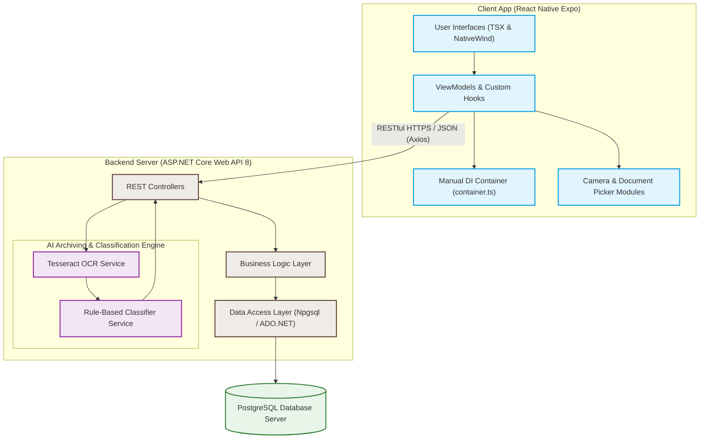
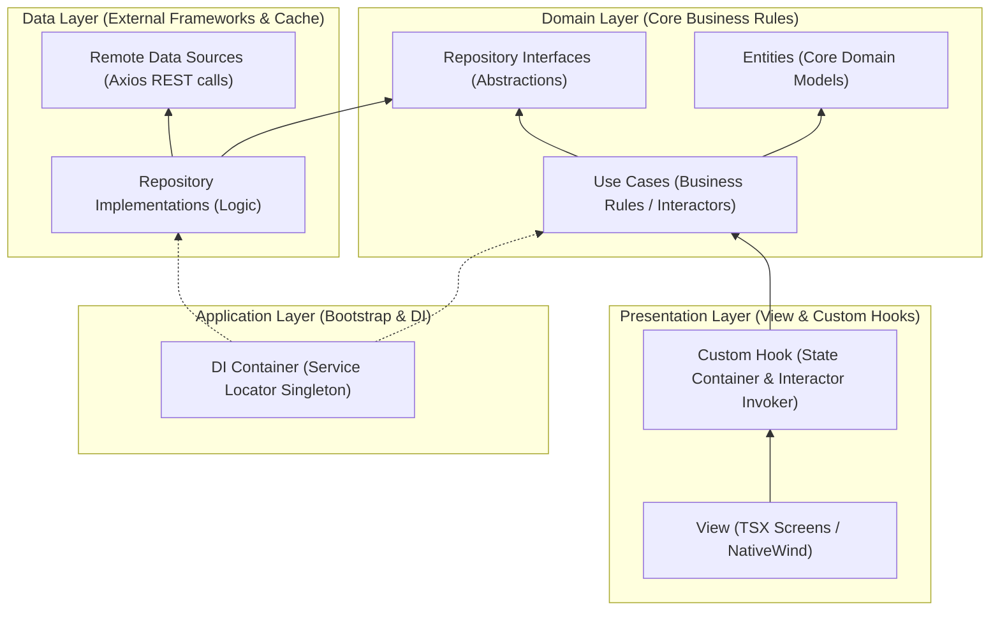
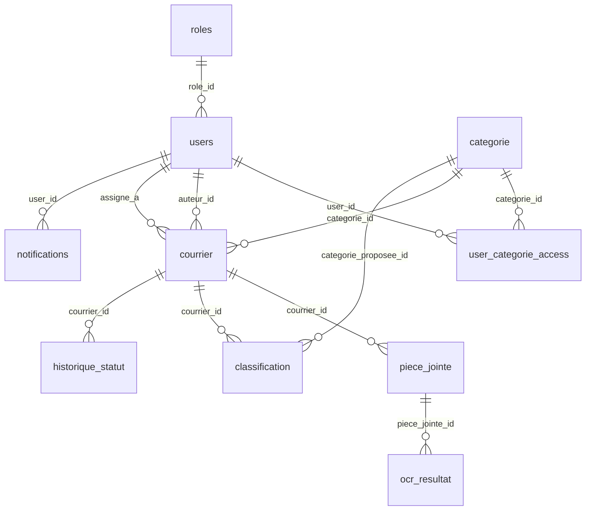

# 📄 Technical Documentation: Smart Mail Room & Intelligent Archiving System
## (Application Mobile Bureau d'Ordre & Archives Intelligent)

Welcome to the comprehensive technical documentation for the **Smart Mail Room & Intelligent Archiving System (Bureau d'Ordre et Archives Intelligent)**. This document provides an exhaustive, low-level technical guide to the system's architecture, database design, artificial intelligence pipelines, and security protocols.

---

## 📌 Table of Contents
1. [Introduction & Objectives](#1-introduction--objectives)
2. [System Architecture](#2-system-architecture)
   - [High-Level Architecture](#high-level-architecture)
   - [Backend Architecture (.NET 8)](#backend-architecture-net-8)
   - [Frontend Architecture (React Native Expo)](#frontend-architecture-react-native-expo)
3. [Project Directory Structure](#3-project-directory-structure)
   - [Backend Folder Structure](#backend-folder-structure)
   - [Frontend Folder Structure](#frontend-folder-structure)
4. [Database Schema & Design](#4-database-schema--design)
   - [Entity-Relationship Diagram (ERD)](#entity-relationship-diagram-erd)
   - [Database Tables & Fields](#database-tables--fields)
   - [Stored Procedures & Database Triggers](#stored-procedures--database-triggers)
5. [Intelligent Archiving & OCR Classification Engines](#5-intelligent-archiving--ocr-classification-engines)
   - [Tesseract OCR Service](#tesseract-ocr-service)
   - [Rule-Based Document Classifier](#rule-based-document-classifier)
6. [Role-Based Access Control (RBAC) & Security](#6-role-based-access-control-rbac--security)
   - [System Roles (Admin, SuperAgent, Agent, Lecteur)](#system-roles-admin-superagent-agent-lecteur)
   - [Custom Security Authorization Handlers](#custom-security-authorization-handlers)
7. [Deployment & Installation Guide](#7-deployment--installation-guide)

---

## 1. Introduction & Objectives

Modern public and private institutions process high volumes of incoming and outgoing paper-based mail and correspondence daily (referred to as *Courrier Entrant/Sortant* or *Bureau d'Ordre*). The **Smart Mail Room & Intelligent Archiving System** is an advanced enterprise-grade solution designed to completely digitize, index, search, and secure this paper flow. 

The application integrates high-end mobile engineering with server-side AI processing to achieve:
* **Rapid Digitization (Numérisation Express):** Instantly capture physical documents using the smartphone camera and upload them as digital attachments.
* **Optical Character Recognition (OCR):** Automatically extract printed text from uploaded attachments (supporting French, English, and Arabic) to make static documents fully searchable.
* **Intelligent Document Classification:** Parse extracted text and auto-suggest the corresponding administrative category (e.g., HR, Financial, Legal, Technical) to minimize manual sorting.
* **Task Assignment & Workflows:** Assign incoming mail tasks to specific agents, monitor statuses (Pending, In Progress, Processed, Rejected), and track status transition histories.
* **Granular Data Privacy (Lecteur Category Access):** Ensure strict data isolation. Readers (*Lecteurs*) can only access documents belonging to categories explicitly assigned to them by the Administrator.

---

## 2. System Architecture

### High-Level Architecture
The system is built on a modular **Client-Server Architecture** utilizing stateless RESTful APIs communicating over HTTPS using standard JSON payloads.



---

### Backend Architecture (.NET 8)
The backend architecture is structured around a strict **Layered Pattern** to achieve absolute separation of concerns (SoC):

1. **Presentation Layer (Web API):**
   * Exposes secure REST controllers to handle incoming mobile requests.
   * Manages global configurations (CORS policies, JWT Bearer Authentication, and custom authorization requirements).
   * Integrates the Tesseract OCR and the rule-based classification service directly into controller actions.
2. **DTO Layer (Data Transfer Objects):**
   * Acts as a decoupled interface between the database entities and mobile payloads, enhancing API contract stability and data security.
3. **Business Layer:**
   * Validates inputs, implements business rules, orchestrates operations, and processes notifications.
4. **Data Access Layer (ADO.NET Npgsql):**
   * Eschews heavy ORMs in favor of direct, raw **Npgsql ADO.NET connections** to execute highly optimized **PostgreSQL Stored Procedures**. This delivers superior response times, eliminates N+1 query problems, and prevents SQL injection attacks.

---

### Frontend Architecture (React Native Expo)
The mobile application is engineered using **Clean Architecture** (pioneered by Robert C. Martin / Uncle Bob) combined with **React Custom Hooks as Presentation Interactors (State Containers / Controllers)** and the **Functional Result Pattern (`Result<T, E>`)**. The codebase is organized into highly decoupled, feature-driven modules (e.g., `auth`, `courrier`, `dashboard`, `notifications`).



#### Detailed Architectural Layer Analysis

1. **Domain Layer (Core / Inner Circle):**
   * **Framework Independence:** The Domain layer is the heart of the module and is entirely isolated from external libraries, API clients (Axios), UI frameworks (React Native), and navigation utilities.
   * **Entities (Core Models):** Plain TypeScript objects defining data contracts (e.g., `User`, `Courrier`, `PieceJointe`).
   * **Repository Interfaces:** Abstract contracts (interfaces) detailing what database operations are available, without specifying how they are implemented.
   * **Use Cases (Interactors):** Represent a single, isolated application-specific business rule (e.g., `GetCourriersUseCase`, `ArchiveCourrierUseCase`). Use Cases depend solely on Repository Interfaces, executing domain-specific logic.

2. **Data Layer (Outer Circle - Implementation):**
   * **Data Sources:** Interfaces and classes managing raw HTTP operations using **Axios** (configured with interceptors, authorization token headers, and automated request retries).
   * **Repository Implementations:** Concrete implementations of Domain Repository Interfaces (e.g., `CourrierRepositoryImpl`). They handle the logic of fetching data from remote API endpoints, converting/mapping raw server DTO payloads into clean Domain Entities, and returning them inward to the Use Cases.

3. **Presentation Layer (Outer Circle - User Interface):**
   * Decouples user interface rendering from state and data logic using **React Custom Hooks** and the **Functional Result Pattern (`Result<T, E>`)**:
     * **The View (TSX):** Passive, layout-focused React Native functional components styled with **NativeWind (Tailwind CSS)**. Views are strictly responsible for layout rendering and user interaction captures. They have no knowledge of API endpoints, loading states, or validation logic.
     * **The Custom Hook (Presentation Interactor / State Container):** Exposes UI states and trigger methods (e.g., `useSuperAgentDashboard`). The hook maintains React States (`data`, `isLoading`, `error`), resolves the required **Domain Use Case** from the `DIContainer` singleton, triggers it asynchronously, processes the functional `Result` payload (using `result.isSuccess()`), and exposes only read-only values and the trigger methods (`refetch`) back to the View.
     * **The Model:** Domain Entities consumed by both the View and the Custom Hook.

4. **Application Layer (Bootstrapping & Dependency Resolution):**
   * **Decoupled Wiring via `DIContainer`:** A manual Dependency Injection Container (`DIContainer.ts`) acts as a central **Service Locator**. It acts as the bootstrap registry where all components are declared:
     1. Remote data sources are instantiated.
     2. Repository implementations are constructed and injected with the data sources.
     3. Use Cases are constructed and injected with the repository implementations.
   * This manual wiring prevents circular dependencies, decouples modules completely, and allows developers to easily mock repositories and use cases during automated **Unit Testing** without touching any UI component.


---

## 3. Project Directory Structure

### Backend Folder Structure
```markdown
📁 Backend/
├── 📁 Presentation/             # Presentation Layer (API endpoints)
│   ├── 📁 Controllers/          # REST Controllers (Auth, Courrier, Users, PiecesJointes...)
│   ├── 📁 Services/             # OCR & AI Services
│   │   ├── 📁 Ocr/              # Tesseract OCR engine integration
│   │   └── 📁 Classification/   # Rule-based keyword matching service
│   ├── 📁 Authorization/        # Security policy handlers (ownership & roles)
│   ├── 📄 Program.cs            # API bootstrap and Dependency Injection configuration
│   ├── 📄 Dockerfile            # Container configuration
│   └── 📄 docker-compose.yml    # Full local orchestration stack
├── 📁 Business Layer/           # Business logic and validation models
├── 📁 Data Access/              # Raw Npgsql ADO.NET database operations
└── 📁 DTO/                      # Decoupled Data Transfer Objects
```

### Frontend Folder Structure
```markdown
📁 frontend/app/
├── 📁 src/
│   ├── 📁 application/          # Application wrappers, providers, and routes (app.tsx)
│   ├── 📁 core/                 # Shared core utilities
│   │   ├── 📁 di/               # DI Container registration (container.ts)
│   │   ├── 📁 network/          # Axios HTTP Client and endpoint URLs
│   │   └── 📁 storage/          # Secure persistent token storage
│   ├── 📁 shared/               # Reusable UI widgets and layout constants
│   └── 📁 modules/              # Feature modules (Domain-Driven design)
│       ├── 📁 auth/             # Authentication and session management
│       ├── 📁 courrier/         # Mail and correspondence features
│       ├── 📁 dashboard/        # Role-specific dashboard views
│       └── 📁 notifications/    # Push notifications and tracking lists
```

---

## 4. Database Schema & Design

The persistence engine relies on **PostgreSQL 18** (compatible with 15+). The database uses transactional stored procedures and triggers to enforce referential integrity and execute automated workflows directly inside the database engine.

### Entity-Relationship Diagram (ERD)



---

### Database Tables & Fields

#### 1. `roles` (User Roles)
Stores administrative roles.
* `id` (INTEGER, PK): Auto-incremented unique identifier.
* `nom` (VARCHAR(255)): Name of the role (`Admin`, `SuperAgent`, `Agent`, `Lecteur`).
* `description` (TEXT): Description of permissions assigned to this role.

#### 2. `users` (User Accounts)
Stores user accounts with credentials hashed with BCrypt.
* `id` (INTEGER, PK): Unique identifier.
* `firstname` (VARCHAR(100)): First name.
* `lastname` (VARCHAR(100)): Last name.
* `email` (VARCHAR(255), UNIQUE): Email address acting as login username.
* `password_hash` (TEXT): Secure password hash.
* `role_id` (INTEGER, FK -> `roles.id`): Associated role.
* `isactif` (BOOLEAN): Flag determining if the account is active or deactivated.
* `image_path` (VARCHAR(900)): Path to the user profile avatar on the server.

#### 3. `categorie` (Mail Categories)
Represents administrative divisions for files and correspondence.
* `id` (INTEGER, PK): Unique identifier.
* `nom` (VARCHAR(100)): Category name (e.g., `Human Resources`, `Financial`, `Legal`, `Technical`).
* `description` (TEXT): Description of files stored under this category.

#### 4. `user_categorie_access` (Category Permission Matrix)
Maps category permissions to readers (*Lecteurs*) for strict data segregation.
* `id` (INTEGER, PK): Unique mapping identifier.
* `user_id` (INTEGER, FK -> `users.id`): Associated reader user.
* `categorie_id` (INTEGER, FK -> `categorie.id`): Permitted category.

#### 5. `courrier` (Mail & Correspondence Registry)
The core table storing metadata, statuses, and OCR summaries for mails.
* `id` (INTEGER, PK): Unique mail identifier.
* `reference` (VARCHAR(100)): Unique registration reference code (e.g. `BO-2026-0034`).
* `type` (VARCHAR(50)): Mail direction (`Entrant` (Incoming), `Sortant` (Outgoing), `Archive`).
* `date_courrier` (DATE): Document date.
* `expediteur` (VARCHAR(255)): Document sender.
* `destinataire` (VARCHAR(255)): Document receiver.
* `objet` (VARCHAR(255)): Subject title of the mail.
* `description` (TEXT): Detailed notes.
* `statut` (VARCHAR(50)): Operational state (`EN_ATTENTE`, `EN_COURS`, `TRAITE`, `REFUSE`).
* `texte_ocr` (TEXT): Consolidated text compiled from all attachment OCR extractions.
* `categorie_id` (INTEGER, FK -> `categorie.id`): Selected administrative division.
* `auteur_id` (INTEGER, FK -> `users.id`): Author agent who registered the mail.
* `assigne_a` (INTEGER, FK -> `users.id`, NULLable): Target agent assigned to process this mail.
* `date_echeance` (TIMESTAMP, NULLable): Task deadline date.

#### 6. `piece_jointe` (Document Attachments)
Stores information about uploaded physical documents.
* `id` (INTEGER, PK): Unique attachment identifier.
* `courrier_id` (INTEGER, FK -> `courrier.id`): Associated mail registry.
* `nom_fichier` (VARCHAR(255)): Original file name.
* `type_fichier` (VARCHAR(100)): MIME type (e.g., `image/png`, `application/pdf`).
* `chemin_fichier` (TEXT): Server-side physical path where the file is stored.
* `format` (VARCHAR(30)): Extension format (e.g., `.png`, `.jpg`).
* `taille` (BIGINT): File size in bytes.
* `est_scan` (BOOLEAN): Status flag showing if this file has undergone OCR scanning.

#### 7. `ocr_resultat` (OCR Extraction Log)
Stores exact extracted text block and OCR engine confidence for individual attachments.
* `id` (INTEGER, PK): Unique log identifier.
* `piece_jointe_id` (INTEGER, FK -> `piece_jointe.id`): Source scanned attachment.
* `texte_extrait` (TEXT): Raw text output from Tesseract.
* `confiance` (DOUBLE PRECISION): Recognition confidence percentage.
* `corrige_manuellement` (BOOLEAN): Identifies if the text was manually corrected by an agent.

#### 8. `classification` (AI Classification Log)
Tracks automatically suggested categories and their verification status.
* `id` (INTEGER, PK): Unique classification identifier.
* `courrier_id` (INTEGER, FK -> `courrier.id`): Processed mail.
* `categorie_proposee_id` (INTEGER, FK -> `categorie.id`): Suggested category.
* `score_confiance` (DOUBLE PRECISION): Categorizer confidence score.
* `methode` (VARCHAR(100)): Algorithm method used (`OCR_RULE_BASED`).
* `validee_par_utilisateur` (BOOLEAN): Flag showing if the classification suggestion was verified by the user.
* `validee_par` (INTEGER, FK -> `users.id`, NULLable): Validator user who confirmed the suggestion.

#### 9. `historique_statut` (Workflow Auditing Trail)
Audits the complete history of mail status transitions.
* `id` (INTEGER, PK): Unique log identifier.
* `courrier_id` (INTEGER, FK -> `courrier.id`): Associated mail.
* `ancien_statut` (VARCHAR(50)): Previous status state.
* `nouveau_statut` (VARCHAR(50)): New status state.
* `modifie_par` (INTEGER, FK -> `users.id`): User who made the status update.
* `commentaire` (TEXT, NULLable): Reason or comments on the change.
* `changed_at` (TIMESTAMP): Actual timestamp of the update.

---

### Stored Procedures & Database Triggers
The PostgreSQL engine runs transactional logic internally via **PL/pgSQL functions** to guarantee atomic operations and secure checks:

1. **Lecteur Category Constraint Trigger (`check_user_is_lecture()`):**
   * Enforces that only users with the `Lecteur` (Reader) or `SuperAgent` role can be registered inside `user_categorie_access`. This prevents accidental category lock-outs or illegal data visibility matrices.
2. **Status Transition Tracker Function (`fn_courrier_update_statut_with_history()`):**
   * Updates the mail's current status and automatically records a comprehensive auditing line in the `historique_statut` table inside a single database transaction.
3. **OCR Processing Confirmation (`fn_piece_jointe_confirm_ocr()`):**
   * Simultaneously logs the OCR text output, appends the text to the parent mail summary, sets the attachment to scanned (`est_scan = TRUE`), creates an AI classification recommendation record, and updates the mail category in one fast atomic operation.

---

## 5. Intelligent Archiving & OCR Classification Engines

### Tesseract OCR Service
The backend embeds **Tesseract OCR (fra+eng+ara)** to process image-based attachments (`.png`, `.jpg`, `.jpeg`, `.bmp`, `.tiff`). The pipeline operates as follows:
1. Validates that the file conforms to standard image extensions.
2. Combines trained datasets: If the Arabic training pack (`ara.traineddata`) is available in the `tessdata` directory, the engine initializes multi-language processing (`fra+eng+ara`). Otherwise, it falls back to French and English (`fra+eng`).
3. Loads image pixels using `Pix.LoadFromFile(filePath)`, processes the document, and returns the raw extracted string alongside the mean confidence percentage.

---

### Rule-Based Document Classifier
Once Tesseract extracts the text, the server runs a rule-based categorization classifier. The text is normalized (lowercase, accent removal) and scanned against distinct corporate keyword arrays:

| Targeted Category | Matching Keywords |
| :--- | :--- |
| **Human Resources** | conge, congé, absence, employe, employé, ressources humaines, rh, recrutement, salaire, attestation de travail, training... |
| **Financial** | budget, facture, paiement, finance, comptable, tresorerie, devis, virement, invoice, payment, accounting... |
| **Legal** | juridique, contrat, plainte, loi, contentieux, tribunal, avocat, reglement, contract, dispute, law... |
| **Technical** | technique, maintenance, informatique, systeme, IT, reseau, serveur, support technique, panne... |
| **Administrative** | administratif, administrative, dossier, demande, autorisation, attestation, circulaire, note interne... |
| **Archive** | archive, archivage, stockage, storage, document archive, classement, conservation... |

#### Confidence Scoring Formula:
The engine applies a linear scoring logic representing the frequency and diversity of matched terms:
$$\text{Confidence Score} = \min(95, 50 + (\text{matched\_keywords\_count} \times 15))$$
*One keyword match grants a baseline confidence of $65\%$, and additional unique keyword hits increase the score up to a strict ceiling of $95\%$. This creates a highly accurate, explainable AI recommendation model.*

---

## 6. Role-Based Access Control (RBAC) & Security

The system implements security checks spanning multiple levels, protecting resources from unauthorized access and preventing data leaks.

### System Roles (Les 4 Rôles)
1. **Administrator (`Admin`):**
   * Manages staff user accounts (CRUD, password resets, activation/deactivation).
   * Defines and assigns category permission structures to Readers.
2. **SuperAgent (`SuperAgent`):**
   * Monitors broad administrative statistics, executes advanced reporting, and oversees overall OCR results across the organization.
3. **Agent (`Agent`):**
   * Operates on files. Registers new incoming/outgoing mail, scans attachments, executes OCR pipelines, and verifies classification categories.
4. **Reader (`Lecteur`):**
   * Has a restricted, high-privacy interface. A Reader can only view mail items and files whose categories match the access rules explicitly assigned to them by the `Admin` in the `user_categorie_access` table.

---

### Custom Security Authorization Handlers
The REST API registers specific authorization rules extending `AuthorizationHandler<TRequirement, TResource>` to restrict unauthorized data access:

* **Account Ownership Handler (`UserOwnerOrAdminHandler`):**
  * Ensures that a user can only query, view, or update their own personal user information, avatar, and settings. Only users in the `Admin` role can bypass this check.
* **Mail Registry Ownership Handler (`CourrierOwnerOrAdminHandler`):**
  * Restricts access to a mail entry. A user can only view or modify a mail registry if they are the author who created it (`AuteurId`), the assignee assigned to process it (`AssigneA`), or if they hold the global `Admin` role.

---

## 7. Deployment & Installation Guide

### Prerequisites
* **.NET 8.0 SDK** or runtime installed on the server machine.
* **PostgreSQL (15+)** server database running on port 5432.
* **Tesseract OCR** binary engine and trained language models (`fra.traineddata`, `eng.traineddata`, `ara.traineddata` inside the `tessdata` folder).
* **Node.js (v18+)** and **Expo CLI** for running the mobile application.

### Backend Setup
1. Configure your PostgreSQL connection string in `clsSeting.cs` or set the connection string inside your system environment variables:
   ```bash
   Host=localhost;Port=5432;Database=order_management_archive;Username=postgres;Password=sa123456
   ```
2. Restore the database structure and initial stored procedures from the SQL backup dump:
   ```bash
   psql -U postgres -d order_management_archive -f Database/backup.sql
   ```
3. Navigate to the `Backend/Presentation` folder and launch the web server:
   ```bash
   dotnet restore
   dotnet run
   ```
   *This starts the REST API on your localhost. You can access Swagger at `/swagger` to test the API endpoints.*

### Mobile Application Setup
1. Navigate to the `frontend/app` folder and install dependencies:
   ```bash
   npm install
   ```
2. Make sure the API base URL in `apiClient.ts` (inside `src/core/network`) points to your running backend IP or localhost address.
3. Start the Expo development packager:
   ```bash
   npx expo start
   ```
   *Use the QR code shown in your terminal to open and run the application on your physical iOS/Android device using the Expo Go application.*

---

> [!TIP]
> **Academic Presentation & PFE Tip:**
> This system is built around SOLID design patterns and enterprise architecture guidelines. Highlighting the **manual dependency injection system (`DIContainer.ts`)** and the **raw Npgsql Stored Procedure execution layer** during your university presentation will demonstrate an exceptional grasp of software engineering best practices.
